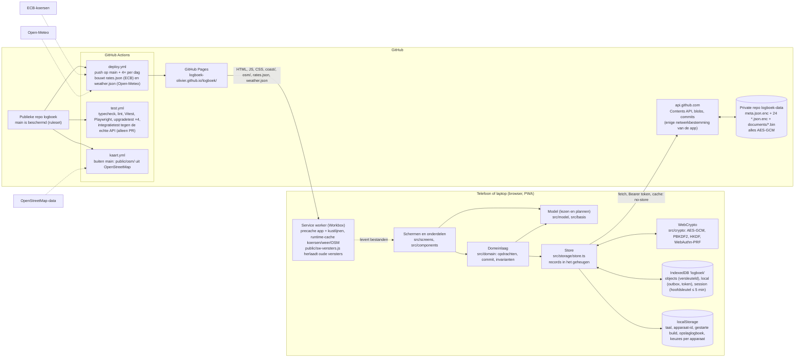
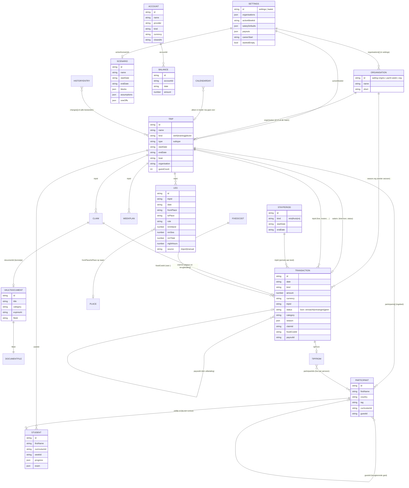

# Kaart van de app

Onafhankelijke review, 3 november 2026, op commit `158102b` (na PR #132). Geschreven voor iemand die de code nooit zag.
Alles hieronder is in de code gecontroleerd; waar CLAUDE.md iets anders zegt, staat dat erbij als **afwijking** (de
bevindingen zelf staan in `docs/review.md`). Regelnummers verwijzen naar de genoemde commit.

Dit is de enige architectuurbeschrijving naast CLAUDE.md: het oude `docs/ARCHITECTUUR.md` (31 oktober) verwijst hierheen;
wat daar nog niet hier stond (sectie 10, wat in de browser staat) is overgenomen. De huidige dataversies staan in sectie 7
en worden door `tests/review-versies.test.ts` tegen `src/model/schema.ts` gecontroleerd.

## 1. Architectuur

Wat waar draait:

| Waar | Wat | Bewijs |
|---|---|---|
| Browser van de gebruiker | Alles wat met data gebeurt: ontsleutelen, samenvoegen, rekenen, tonen. Er is geen server van de app. | `src/storage/store.ts`, `src/crypto/*` |
| api.github.com | Opslag van versleutelde bytes (Contents API), geschiedenis (commits-API), onveranderlijke versies (blob-API). GitHub ziet alleen ciphertext, bestandsnamen en commitberichten `sync <tijd> v<versie>+<commit> d<apparaat>`. | `src/storage/github.ts:16` (`DATA_REPO`), `commitMessage` |
| GitHub Pages | Statische bestanden van de app (13 MB in `dist/`, waarvan 5 MB precache). | `vite.config.ts`, `npm run build` |
| GitHub Actions | Bouwen, testen, deployen; ophalen van koersen, weer en kaartdata. De app zelf haalt nooit iets van ECB, Open-Meteo of OSM. | `.github/workflows/*.yml`, CSP in `index.html:5` |

**Huidige dataversies: schemaversie 4, schrijfversie 10** (`src/model/schema.ts`; de versies veranderen per PR, de test
`tests/review-versies.test.ts` bewaakt deze regel en de getallen in sectie 5 en 7).

## 2. Mappen en modules

Totaal 55.099 regels in `src/` (TypeScript, TSX en CSS). Per map, met de belangrijkste bestanden en wie wie aanroept
(aantal importregels tussen mappen, gemeten op de genoemde commit).

| Map | Regels | Doet | Belangrijkste bestanden | Roept aan |
|---|---|---|---|---|
| `src/` (wortel) | ~1.900 | Opstart, sessie (ontgrendelen, vergrendelen, herstel), terugknop, foutdetails, demo | `session.ts` 1.163, `App.tsx`, `repair.ts` 306, `demo.ts`, `back.ts`, `errors.ts`, `lazy.ts`, `updates.ts` | storage, crypto, screens |
| `src/screens/` | 10.484 | 33 schermen; `Home.tsx` is de router (schermkeuze, Toevoegen als laag, automatische stappen na de sync) | `Planning.tsx` 1.126, `QuickAdd.tsx` 705, `Students.tsx` 658, `Money.tsx` 613, `Accounts.tsx` 589, `Storage.tsx` 545, `Setup.tsx` 502, `Home.tsx` 461 | components (215), model (132), i18n (39), storage (35), domain (26) |
| `src/components/` | 12.399 | 80 herbruikbare onderdelen: bladen (`Sheet`), leesweergaven (`Views`), bewerkbladen (`EditSheets`), de periodepagina, kaarten, grafieken, geld | `SeaMap.tsx` 812, `GoalSheets.tsx` 682, `DaySheet.tsx` 564, `WeekSheet.tsx` 548, `Scenario.tsx` 493, `Position.tsx` 479, `Claims.tsx` 472, `EditSheets.tsx` 465, `PeriodPage.tsx` 462 | model (216), i18n (78), domain (58), storage (50), basis (45), **screens (9)** |
| `src/domain/` | 2.063 | De enige weg naar de opslag: benoemde opdrachten, `commit` (één transactie over alle bestanden), invarianten, relaties, geschiedenis, prullenbak, geldmodel en geldrapporten | `commit.ts`, `tx.ts`, `invariants.ts`, `relaties.ts`, `geld.ts` (50 opdrachten), `trips.ts`, `geldrapport.ts`, `doorklik.ts` 362, `geld-omzetten.ts` | model (96), basis (10) |
| `src/model/` | 11.830 | Typen en afgeleide data: lezen en plannen van wijzigingen (schrijven alleen met een `Tx`) | `types.ts` 866, `position.ts` 605, `calendar.ts` 473, `stats.ts` 444, `weeks.ts` 440, `plans.ts` 417, `waterroute.ts` 385, `places.ts` 353, `scenario.ts` 344 | types (59), basis (53), **domain (52, waarvan 16 geen type-import)**, derive (35) |
| `src/basis/` | 260 | Eén plek voor datums (`datum.ts`), bedragen (`bedrag.ts`), organisaties (`organisatie.ts`), vergelijken (`gelijk.ts`) | — | model/types, i18n |
| `src/storage/` | 3.434 | IndexedDB, outbox, GitHub-client, sync per bestand, integriteit (sha), schrijfversie-bewaking, bewijs, back-up, kluisbestanden | `store.ts` 1.677, `github.ts` 399, `sync.ts` 250, `evidence.ts`, `storage-log.ts`, `backup.ts`, `writer.ts`, `versions.ts` | crypto (12), model (11) |
| `src/crypto/` | 657 | Objectformaat, sleutelbeheer (`meta.json.enc`), PBKDF2, herstelcode (BIP39), WebAuthn-PRF | `keys.ts` 347, `encrypt.ts`, `passphrase.ts`, `recovery.ts`, `webauthn.ts` | — |
| `src/import/` | 1.657 | CSV en Excel lezen (`rows.ts`, `csv.ts`, `xlsx.ts`, `xml.ts`), mijlen (`mileage-csv.ts` 354, `apply.ts`), planning, bankstanden (`accounts.ts` 365) | — | model (15) |
| `src/i18n/` | 4.619 | 2.180 vertaalsleutels in `nl.ts` (bron) en `en.ts` (type-gelijk, dus compleet) | `nl.ts` 2.278, `en.ts` 2.237, `labels.ts` | — |
| `src/demo/` | 295 | Verzonnen voorbeelddata voor de demomodus | `data.ts` | model |
| `src/app.css` | 4.897 | Het hele ontwerpsysteem in één bestand | — | — |

**Meest gebruikte bestanden (fan-in, aantal importerende bestanden):** `model/types.ts` 158, `i18n` 116, `storage/store.ts`
83, `components/Icon.tsx` 82, `basis/datum.ts` 74, `format.ts` 67, `model/derive.ts` 62, `components/useCollection.ts` 56,
`components/EditSheets.tsx` 54, `domain/tx.ts` 53.

**Bestanden met de meeste imports (fan-out):** `screens/QuickAdd.tsx` 38, `screens/Money.tsx` 37, `components/PeriodPage.tsx`
34, `components/DaySheet.tsx` 34, `screens/Today.tsx` 33, `screens/Agenda.tsx` 30.

Te groot of te verweven (bewijs: regels en imports hierboven, `npx vite build`-waarschuwingen):

- `src/storage/store.ts` (1.677 regels) doet opslaan, sync, herstel, controle, bewijs én kluisbestanden in één klasse met
  ruim 60 methoden. Het is de kern; het is ook het bestand waar elke storingsregel uit
  CLAUDE.md doorheen loopt.
- `src/session.ts` (1.163 regels): eerste keer, koppelen, ontgrendelen op vier manieren, vergrendelen, wachtzin wijzigen,
  token vervangen, herstel en meta terugzetten in één klasse.
- `src/screens/Planning.tsx` (1.126 regels) en `src/screens/QuickAdd.tsx` (705 regels, 38 imports).
- `src/app.css` (4.897 regels): één bestand zonder indeling per onderdeel.
- **Lagen lopen door elkaar:** `src/components/` importeert 9 keer uit `src/screens/` (`DaySheet` → `Deadlines`,
  `History`, `QuickAdd`; `PeriodPage` → `Planning`, `Students`; `MileageImport` en `ExportSection` → `Setup`;
  `PeriodMoneyAdd` → `QuickAdd`), en `src/model/` importeert 16 keer echte code uit `src/domain/` (`geldmodel`,
  `geldrapport`, `history`). Het plaatje in `docs/FUNDERING.md` (schermen → domein → store, model eronder) klopt daardoor
  niet helemaal: model en domein zijn één laag geworden.
- **Lui laden werkt niet voor alles:** `npx vite build` meldt `INEFFECTIVE_DYNAMIC_IMPORT` voor `screens/More.tsx`,
  `screens/History.tsx` en `screens/Deadlines.tsx`: ze worden door `Home.tsx` lui geladen maar door `DaySheet`, `Agenda`,
  `Today`, `Vault`, `Career` en `PeriodMenu` statisch geïmporteerd, dus zitten ze toch in de eerste bundel.
- **Dode of alleen door tests gebruikte exports** (gemeten: gedefinieerd in één bestand, nergens anders in `src/` gebruikt):
  `dagsoortZetten`, `daysRange`, `doelOpslaan`, `openStorage`, `scenarioEindeAanpassen`, `studentToevoegen`,
  `uitgaveperiodeKiezen` (nergens gebruikt, ook niet in tests); `dagsoortAutomatisch`, `dagsoortenZetten`,
  `deelnemerToevoegen`, `periodeHernoemen`, `weekAfsluiten`, `geldstapOpslaan`, `scenarioBeginAanpassen`, `sumPerCurrency`,
  `putSessionKey`, `saveOutbox`, `parseMileageCsv`, `reviewInput` (alleen in tests). Ongeveer 220 van de 1.825 exports
  worden alleen in het eigen bestand gebruikt (vooral typen; dat is geen probleem).

## 3. Data

Alle 24 databestanden hebben hetzelfde formaat: `versie(1) | iv(12) | AES-GCM(ciphertext + tag)` onder de hoofdsleutel met
het pad als AAD (`src/crypto/encrypt.ts`); de inhoud is `{format: 'logboek-collection', schemaVersion: 4, minWriterVersion: 10,
records: [...]}` (`src/storage/sync.ts:49`). Elk record heeft `id`, `updatedAt` (ISO) en `deletedAt` (ISO of null; een
tombstone). `meta.json.enc` is de uitzondering: platte JSON met salts en de ingepakte hoofdsleutel (zie 4). De kluis
bewaart documenten los als `documents/<uuid>.bin`.

| Bestand | Recordtype | Wat erin staat | Vaste id's |
|---|---|---|---|
| `trips.json.enc` | `Trip` | Periode op het water (werk, training, plezier): naam, soort, subtype, datums, boot, basis, organisatie, deelnemers, review, route, checklists, aantal gasten | `import:` nee (uuid); dagen verwijzen via `tripId` |
| `legs.json.enc` | `Leg` | Eén dag op het water: datum, van, naar (plaatsnaam + land), rol, boot, wind, nm per watertype, nachturen, notitie, `source` import of manual | `import:<trip>:<datum>:<n>` |
| `periods.json.enc` | `StayPeriod` | Periode aan land: reis, thuis, vrij; datums, naam, reisgegevens | `periode:<soort>:<start>` (migratie) |
| `calendar.json.enc` | `CalendarDay` | Alleen dagen die de gebruiker zelf instelt: dagtoestand (beschikbaar, optie, onbeschikbaar) of gegevens van een dag | `dag:<jjjj-mm-dd>` |
| `transactions.json.enc` | `Transaction` | Al het geld: fooi, loon (salaris), bonus, terugbetaling, overig inkomen, kosten, investering; bedrag, valuta, koers, periode, status (loon), seizoen, soort uitgave, declaratie, vaste last, uitbetaling | `salaris:<trip>`, `vast:<vaste last>:<jjjj-mm>`, `uitgave:<declaratie>`, `terugbetaling:<declaratie>` |
| `settings.json.enc` | `Settings` | Instellingen (record `settings`) plus per apparaat `laatst:<apparaat-id>` met de laatst gebruikte boot, rol, valuta enzovoort | `settings`, `laatst:<id>` |
| `accounts.json.enc` | `Account` | Rekening: naam, aanbieder, soort (betaal, spaar, beleggen, bezit, schuld, contant), valuta, opgeheven | uuid |
| `balances.json.enc` | `Balance` | Stand van een rekening op een dag | `stand:<rekening>:<jjjj-mm-dd>` (oud: `:<jjjj-mm>`) |
| `fixedcosts.json.enc` | `FixedCost` | Vaste last: naam, valuta, bedrag per maand vanaf een maand | uuid |
| `claims.json.enc` | `Claim` | Declaratie: datum, trip, notitie, bedrag, status, bonnetje (`documentId`), terugbetaling | uuid |
| `scenarios.json.enc` | `Scenario` | Scenario voor de vooruitblik: blokken (weken × inkomen), aannames (groei, rente, belegd deel), eenmalige uitgaven, horizon | uuid |
| `students.json.enc` | `Student` | Student (voornaam, cursus, niveau, voortgang, examen) gekoppeld aan een trip | zelfde id als de deelnemer |
| `plans.json.enc` | `WeekPlan` | Lesplanning: groepen, dagen met blokken (dagdeel, thema's, onderwerpen) | uuid |
| `curricula.json.enc` | `Curriculum` | Alleen eigen en bewerkte cursussen; de meegeleverde (ASA, RYA, CWO) staan in de code | `seed-asa-101` … |
| `checklists.json.enc` | `Checklist` | Alleen eigen en bewerkte checklists; meegeleverde in de code | `seed-…` |
| `places.json.enc` | `Place` | Plaats met een punt op de kaart (naam, lat, lon, land); dagen verwijzen op naam | uuid |
| `reminders.json.enc` | `Reminder` | Termijn: deadline of vervaldatum, herhaling | uuid |
| `weekreviews.json.enc` | `WeekClosing` | Weekafsluiting: cijfer en één zin | `week:<jjjj>-W<ww>` |
| `goals.json.enc`, `skills.json.enc`, `sessions.json.enc` | `Goal`, `Skill`, `Session` | Doelen (zelfvullend of zelf gemeten), skills met mijlpalen, losse sessies en metingen | uuid |
| `career.json.enc` | `Application`, `Contact`, `Project` | Sollicitaties, netwerk (alleen voornaam), projecten | uuid |
| `documents/index.json.enc` | `VaultDocument` | Kluis-index: titel, categorie, datums, `fileId` | uuid |
| `documents/<fileId>.bin` | bytes | Het document zelf, versleuteld met het pad als AAD | willekeurige uuid |
| `history.json.enc` | `HistoryEntry` | Per opdracht de gewijzigde velden vooraf en erna (30 dagen; prullenbak en geschiedenis) | uuid |

**Hoe verwijzingen werken en wat er gebeurt als een verwijzing wegvalt** (gecontroleerd in `src/domain/invariants.ts`,
`src/model/review.ts`, `src/model/claims.ts`, `src/model/accounts.ts`):

| Verwijzing | Op | Als het doel weg is (tombstone) |
|---|---|---|
| `Leg.tripId` → trip | id | Invariant `dag-zonder-trip` (nakijken); de dag blijft staan en staat in Nakijken ("gelogde dag waarvan de trip verwijderd is") met terugzetten of een nieuwe trip. Nooit stil verhuisd. |
| `Transaction.tripId` → trip of periode aan land | id | Invariant `geld-zonder-periode` (nakijken); Nakijken biedt koppelen aan de periode van de datum of een thuisperiode maken. Geld met `season`, `claimId` of `fixedCostId` is uitgezonderd. |
| `Transaction.season.org` → organisatie | id (tekst) | Niets breekt: het jaaroverzicht en per organisatie tonen het id als groep; een organisatie die niet (meer) in de lijst staat heet "Onbekende organisatie" (`src/basis/organisatie.ts`, `orgName` → null). |
| `Trip.organisation` → organisatie | id | Trip blijft te kiezen met "Onbekende organisatie"; de teller telt hem niet (`tripOrganisation` → null als niet `isCounted`). |
| `Student.weekId` → trip | id | Invariant `student-zonder-trip`; de student staat in het Studentenarchief onder "Zonder trip". |
| `Settings.activeWeekId` → trip | id | Invariant `lopende-trip-weg`, fix van één tik in Gezondheid (`src/domain/gezondheid.ts:14`). |
| `Claim.tripId` → trip | id | Declaratie blijft staan ("declaraties zonder trip" in Geld); een trip "alles naar de prullenbak" neemt zijn declaraties mee. |
| `Transaction.claimId` → declaratie | id | Verwijderen van de declaratie haalt de uitgave en het bonnetje weg (`deleteClaim`); een al ontvangen terugbetaling blijft. Andersom: de uitgave verwijderen zet het bedrag van de declaratie op leeg. |
| `Transaction.fixedCostId` → vaste last | id | Geboekte maanden blijven als gewone uitgave staan (ze hangen aan de maand, niet aan de vaste last); niets controleert dit. |
| `Balance.accountId` → rekening | id | `deleteAccount` verwijdert alle standen mee (`src/model/accounts.ts:285`). |
| `Participant.guestId` → eerdere deelnemer | id | Alleen voor "terugkerende gast" en fooi per gast; een ontbrekende gast telt gewoon als aparte persoon. |
| `Claim.documentId` → kluisdocument | id | "Dit bestand is niet te lezen" of "staat nog niet op GitHub"; de declaratie zelf blijft. |
| `Leg.fromPlace/toPlace` → plaats | **naam**, genormaliseerd (`normalizePlaceName`) | De enige koppeling op naam. Hernoemen van een plaats schrijft alle dagen om; zonder pin blijft het een naam. |
| `Settings.activeScenarioId` → scenario | id | `activeScenario` → null: Verwacht toont dan Gepland. |
| `WeekPlan.tripId` → trip | id | Planning blijft en hoort via `startDate` bij de trip waarin die datum valt; niets meldt het. |
| `Participant.curriculumId`, `Student.curriculumId` → cursus | id | Niets controleert het: een verwijderde cursus laat studenten met een checklist zonder onderwerpen achter (`src/model/curricula.ts`, `deleteCurriculum` maakt alleen een tombstone). |
| `PlanGroup.studentIds` → student | id | Stil gefilterd (`src/model/plans.ts`, `studentsFor`); niets meldt het. |
| `Transaction.season.org` → organisatie | id | Nooit gecontroleerd; zie hierboven. |

## 4. Versleuteling en ontgrendelen

| Sleutel | Wat | Waar | Levensduur |
|---|---|---|---|
| Hoofdsleutel (MK) | AES-GCM-256, versleutelt elk databestand, de token en de vingerafdruk-verpakking | Alleen ingepakt: in `meta.json.enc` (GitHub en IndexedDB `objects`), en als niet-exporteerbare `CryptoKey` in IndexedDB `session` zolang de sessie loopt | In het geheugen tot vergrendelen; in `session` hoogstens 5 minuten na het laatste gebruik (`LOCK_AFTER_MS`, `src/session.ts:45`), nooit met een tijd in de toekomst, nooit ouder dan het laatste vergrendelen |
| Wachtzin-KEK | PBKDF2-SHA256, 600.000 rondes, 16-byte salt | Afgeleid bij elk ontgrendelen; alleen de salt en het aantal rondes staan in de meta | Direct na gebruik weg |
| Herstelcode-KEK | HKDF-SHA256 uit 24 BIP39-woorden (256 bit entropie) | Woorden alleen op papier; de entropie staat ook ingepakt onder de wachtzin-KEK in de meta (`recoveryCode`), voor "Herstelcode tonen" na de wachtzin | Idem |
| Vingerafdruk-KEK | WebAuthn met `prf`-extensie → KEK | De ingepakte MK staat **lokaal** in IndexedDB `local` onder `fingerprint` (AAD `local/fingerprint#masterKey`), niet in `meta.json.enc` | Per apparaat; uit te zetten |
| Check-veld | De drie verpakkingen, versleuteld onder MK | In de meta | Bindt een MK aan precies deze meta: elke schrijfactie controleert eerst dat de meta nog bij de sleutel hoort |

Ontgrendelen (`src/session.ts`, `src/screens/Unlock.tsx`): bij openen eerst de sessiesleutel (jonger dan 5 minuten, niet
na een vergrendeling), anders vingerafdruk als die is ingesteld (direct gevraagd zodra het scherm zichtbaar is), anders
wachtzin of herstelcode. Vergrendelen na 5 minuten zonder tik, toets of scroll (`App.tsx` luistert op `pointerdown`,
`keydown`, `touchstart`, `scroll`), handmatig via Instellingen, in elk venster tegelijk (BroadcastChannel). Vergrendelen
wist de sleutel uit het geheugen en uit `session` en maakt de Store leeg. Wachtzin wijzigen pakt dezelfde MK opnieuw in;
de herstelcode blijft dezelfde (geen sleutelwissel, zie `docs/review.md`, Beveiliging).

**Vergeleken met CLAUDE.md:**
- Klopt: AES-GCM met pad als AAD en 12-byte IV, PBKDF2 600.000, 24 woorden BIP39, 5 minuten, niet-exporteerbare sleutel,
  WebAuthn-PRF zonder zwakkere fallback, `safeToAdopt` bij een gewijzigde meta.
- **Afwijking:** CLAUDE.md zegt onder Opslag "`meta.json.enc`: MK versleuteld onder KEK's (wachtzin, herstelcode,
  vingerafdruk)". In de code bevat de meta alleen de wachtzin- en herstelcode-verpakking (`Meta` in `src/crypto/keys.ts:38`);
  de vingerafdruk-verpakking staat alleen op het apparaat. Dat is veiliger dan beschreven, maar de beschrijving is fout.
- **Afwijking (klein):** CLAUDE.md zegt "KEK versleutelt MK (AES-KW of AES-GCM)"; de code gebruikt alleen AES-GCM `wrapKey`.
- De herstelcode-entropie staat niet in CLAUDE.md maar wel in de meta, ingepakt onder de wachtzin-KEK (`AAD_RECOVERY_CODE`).
  Wie de wachtzin heeft, kan dus de herstelcode tonen; wie alleen de herstelcode heeft, niet de wachtzin. Dat is bedoeld
  ("herstelcode tonen (na wachtzin)" bij Instellingen), maar betekent dat een gelekte wachtzin ook de herstelcode lekt.

## 5. Sync

Eén ronde (`Store.runSync`, `src/storage/store.ts:548`), onder het Web Lock `sync` (één venster tegelijk):

1. Niets als de sleutel niet past (`mismatch`), een bestand van een nieuwere versie is (`outdated`), of er na dit venster
   een nieuwere build is gestart (`newerBuildStarted`, `src/storage/versions.ts`).
2. `assertVault` (lokale meta hoort bij de sleutel) en `absorbAll` (opslag van andere vensters overnemen).
3. Alleen de bestanden met iets in de outbox (na een opslag) of alles (ontgrendelen, verversen, 30-secondenvangnet).
4. `checkMeta`: `meta.json.enc` op GitHub moet via het check-veld bij deze sleutel horen; anders niets schrijven
   ("Sleutel past niet", of "Logboek terugzetten op GitHub" als de meta ontbreekt of kapot is).
5. Leespas: elk bestand ophalen (`getFile`, inhoud gecontroleerd tegen de git-blob-sha, `src/storage/integrity.ts`) en
   ontsleutelen vóór er iets geschreven wordt. Onleesbaar → dat pad overslaan en melden; van een nieuwere schemaversie of
   schrijfversie → "Werk de app bij", niets schrijven. Een versie die dit apparaat zelf net verving telt niet.
6. Meegeleverde bestanden (cursussen, checklists) die niet te ontsleutelen zijn, vanzelf terugzetten (hoogstens 2× per dag).
7. Per bestand `syncPath` → `syncCollection` (`src/storage/sync.ts`): samenvoegen per `id` (laatste `updatedAt` wint, bij
   gelijk wint GitHub), `sealForUpload` (versleutelen en direct weer ontsleutelen), PUT met de oude sha als voorwaarde.
   Conflict (409/422) → opnieuw vanaf lezen, hoogstens 3 pogingen (`MAX_ATTEMPTS`). Een nieuw bestand ontstaat alleen hier,
   na een tweede GET die de 404 bevestigt, en wordt daarna teruggelezen (`verifyCreated`).
8. Kluisbestanden uploaden (alleen na `match`, ná de databestanden), verwijderde documentbestanden na 30 dagen van GitHub
   halen.
9. Bewijs ophalen voor onleesbare bestanden (alleen lezen), status zetten.

Tombstones: verwijderen is `deletedAt` zetten; persoonlijke inhoud gaat eruit (`src/domain/tombstone.ts`: studenten,
carrière, documenten, rekeningen, standen, declaraties). Tombstones worden nooit opgeruimd uit de bestanden (ze blijven
voor altijd meegaan in de sync; alleen de inhoud van de geschiedenis wordt na 30 dagen leeg).

Twee apparaten: beide schrijven lokaal en in hun outbox; de eerste die synct wint de PUT, de tweede krijgt een conflict,
leest opnieuw, voegt samen en schrijft. Record-niveau: de laatste `updatedAt` wint, dus twee bewerkingen van hetzelfde record
binnen één sync-interval verliezen de oudste stil (bekende beperking, genoemd bij declaraties en standen in CLAUDE.md).
Een klok die achterloopt wordt opgevangen: `Store.putMany` zet `updatedAt` net na de vorige versie (`justAfter`).

Oude build: elk bestand draagt `minWriterVersion` (nu 10). Een oudere build die een bestand met een hogere schrijfversie
leest, schrijft niets meer en toont "Werk de app bij" (`NewerWriterError`); wat hij lokaal opsloeg blijft in de outbox en
gaat mee na het bijwerken. Een build van vóór de schrijfversie (vóór 31 oktober) kent het veld niet en wordt alleen door
`schemaVersion` (nu 4) tegengehouden. Binnen één apparaat bewaakt `localStorage` `logboek-gestarte-build` dat een bevroren
ouder venster na een update niets meer schrijft (`assertCurrentBuild` in `putFile`/`deleteFile`).

## 6. Domeinlaag

Elke wijziging is een benoemde opdracht in `src/domain/<gebied>.ts`, uitgevoerd door `commit` (`src/domain/commit.ts:60`):
werk op een `Tx`, alleen echt gewijzigde records, controle op nieuwe harde overtredingen, voor automatische opdrachten en
imports de proef op koppelingen (`src/domain/relaties.ts`), één regel geschiedenis, alles in één IndexedDB-transactie,
daarna ongedaan maken per veld. `tests/domeinlaag.test.ts` bewaakt dat alleen `commit` een schrijfhandvat vraagt en dat
schermen geen schrijvende modelfunctie importeren.

Alle opdrachten (156 exports in `src/domain/`, gemeten), per gebied:

| Gebied | Opdrachten |
|---|---|
| `agenda.ts` | dagAutomatisch, dagOpslaan, dagsoortAutomatisch, dagsoortKiezen, dagsoortZetten, dagsoortenKiezen, dagsoortenZetten, landperiodeBewerken, landperiodeVerwijderen, landperiodeZetten, periodeDatumsWijzigen, periodemodelMigreren |
| `dagen.ts` | aanvullen, dagBewerken, dagBewerkenMetTrip, dagLoggen, dagVerwijderen, dagZoalsGepland |
| `trips.ts` | aantalGastenZetten, bootVerwijderen, botenBevestigen, botenOverslaan, botenSamenvoegen, checklistAfvinken, checklistOpslaan, checklistToevoegen, checklistVerwijderen, deelnemerToevoegen, deelnemerVerwijderen, deelnemerWijzigen, geldKoppelen, investeringssoortZetten, landperiodeMaken, nakijkenKloptZo, organisatieBeantwoorden, periodeAfronden, periodeBewerken, periodeHernoemen, periodeMaken, periodeMakenOverDagen, periodeOrganisatieZetten, periodeSoortZetten, periodeVerwijderen, soortenOvernemen, tellerBeginnummersOpslaan, terugkerendeGastBeantwoorden, tripVoorDagen |
| `geld.ts` (50) | eerderSeizoenInvoeren, declaratieBewerken/Ingediend/Terugbetaald/Toevoegen/Verwijderen, geenSalaris, geldBewerken, geldToevoegen, geldVerwijderen, geldstapOpslaan, rekeningOpslaan, rekeningVerwijderen, salarisLaterVragen, salarisOntvangen, salarisOpslaan, standOpslaan, beginsaldiInvoeren, scenarioMaken/Activeren/Hernoemen/BeginAanpassen/Verwijderen/EindeAanpassen/DatumsAanpassen, blokToevoegen/Wijzigen/Verwijderen/Verplaatsen, aannamesOpslaan, eenmaligToevoegen/Wijzigen/Verwijderen, standVerwijderen, standWijzigen, standaardsalarisOpslaan, standenImporteren, uitbetalingInvoeren, uitgaveBewerken, uitgaveToevoegen, uitgaveperiodeKiezen, vasteLastToevoegen/Verwijderen/Wijzigen, vasteLastenBoeken |
| `geld-omzetten.ts` | geldOmzetten (eenmalig, na een tik) |
| `training.ts` | cursusOpslaan, cursusVerwijderen, planningOpslaan, planningVerwijderen, studentArchiveren, studentBewerken, studentInTripToevoegen, studentToevoegen, studentenArchiveren, studentenOpslaan, studentenWissen |
| `plaatsen.ts` | pinVerwijderen, pinZetten, plaatsHernoemen, plaatsOpslaan, plaatsVariantenSamenvoegen, plaatsVerwijderen, plaatsenSamenvoegen |
| `termijnen.ts` | termijnAfronden, termijnOpslaan, termijnVerwijderen, weekAfsluiten, weekAfsluitenMetGeld, weekafsluitingVerwijderen |
| `doelen.ts` | carriereOpslaan, carriereVerwijderen, doelOpslaan, doelOpslaanMetMeting, doelVerwijderen, mijlpaalAfvinken, sessieLoggen, sessieVerwijderen, skillOpslaan, skillVerwijderen |
| `kluis.ts` | documentBewerken, documentToevoegen, documentVerwijderen |
| `instellingen.ts` | instellingenOpslaan, nieuwLogboekInrichten |
| `importeren.ts` | backupTerugzetten, mijlenImporteren, planningImporteren |
| `prullenbak.ts` | terugzetten, tripTerugzetten, geschiedenisTerugzetten, geschiedenisOpruimen |
| `gezondheid.ts` | gezondheidHerstellen |

Lezende, niet-schrijvende modules in dezelfde map: `geldmodel.ts` (wat telt als geboekt geld, salaris per tocht),
`geldrapport.ts` (transactielijst, per organisatie, per werkdag, jaaroverzicht, fooi per gast, resultaat per tocht, Te
controleren), `doorklik.ts` (de posten onder elk bedrag in Geld).

**Invarianten** (`src/domain/invariants.ts`, 9 regels): hard (een opdracht die er een nieuwe maakt schrijft niets):
`datum` (geldige datums in dagen, trips, geld, periodes), `getal` (eindige, niet-negatieve mijlen en nachturen; een bedrag
groter dan 0, behalve salaris 0), `trip-datums` (begin niet na eind). Nakijken (zichtbaar in Meer → Opslag → Gezondheid):
`dag-zonder-trip`, `geld-zonder-periode`, `salaris-zonder-bedrag`, `meerdere-salarissen`, `lopende-trip-weg`,
`student-zonder-trip`. Een fix van één tik bestaat alleen voor `lopende-trip-weg` en `trip-datums` (`canFix`,
`src/domain/gezondheid.ts:10`); CLAUDE.md belooft "een fix van één tik waar dat zonder gokken kan", dat zijn er dus twee
van de negen. Overlap en een deelnemer in meerdere trips zijn bewust geen regel.

**Automatische opdrachten** (`AUTOMATIC` in `relaties.ts`): `periodemodelMigreren`, `studentenArchiveren`,
`nieuwLogboekInrichten`. Die mogen geen koppeling veranderen en geen nieuwe nakijk-overtreding maken; anders niets geschreven
en een melding met foutdetails. `geschiedenisOpruimen`, `vasteLastenBoeken` en de imports mogen geen koppeling veranderen.

**Herstelpunten** (wat een gebruiker terug kan halen, in oplopende zwaarte):
1. Ongedaan maken, 10 seconden (30 bij een periode), per veld (`commit` → `undo`).
2. Meer → Geschiedenis: elke opdracht van de laatste 30 dagen, per regel terugzetten (`src/model/history-view.ts`).
3. Meer → Prullenbak: alles wat in 30 dagen verwijderd is, met wat eraan hing, en wat een import verving (`src/model/trash.ts`).
4. Excel opnieuw importeren als schone herstart voor de geïmporteerde trips en dagen (`src/import/apply.ts`).
5. Back-up terugzetten (alleen wat helemaal ontbreekt; `src/storage/backup.ts`).
6. Meer → Opslag → "Alles herstellen" (onleesbare bestanden op GitHub vervangen door de leesbare kopie) en "Logboek
   herstellen" (onleesbare lokale bestanden; `src/repair.ts`).
7. De git-geschiedenis van `logboek-data`: elke oude versie blijft versleuteld bewaard, maar de app kan die niet zelf
   terughalen (alleen lezen voor het bewijs).

## 7. Dataversies en migraties

| Versie | Sinds | Wat | Hoe gelezen |
|---|---|---|---|
| `schemaVersion` 1 | 24 okt | Eerste formaat (`version: 1` in heel oude bestanden wordt ook herkend) | — |
| `schemaVersion` 2 | 2 nov (PR #126) | Eén waarheid voor geld: salaris als transactie met status; `tipVia`/`depositedAt` vervallen | Versie 1 blijft leesbaar; "Geld omzetten" na een tik (`src/domain/geld-omzetten.ts`) |
| `schemaVersion` 3 | 2 nov (PR #130) | `scenarios.json.enc` | Niets om te zetten |
| `schemaVersion` 4 | 3 nov | Laatst gebruikte valuta per soort invoer (`lastCurrencies`); Mijn positie telt de begindag en waardeert te ontvangen zoals Geld | Niets om te zetten |
| `minWriterVersion` 2 … 10 | 31 okt – 3 nov | Zie `src/model/schema.ts`: periodemodel (2), prullenbak (3), organisaties (4), tripdatums als velden (5), één waarheid voor geld (6), standen per dag (7), scenario's (8), bezittingen en aannames (9), valuta per soort invoer (10) | Een oudere build schrijft niets over een bestand met een hogere schrijfversie |

Omzettingen van bestaande gegevens (allemaal gevonden in de code):

| Omzetting | Waar | Wanneer | Vanzelf? |
|---|---|---|---|
| Periodemodel: agendadagen thuis, reis, rust → periodes aan land | `src/model/migrate-periods.ts`, opdracht `periodemodelMigreren` | Na de eerste geslaagde sync, één keer (`settings.periodsMigratedAt`) | Ja, met de proef op koppelingen; geen koppeling van geld of tripdatums |
| Geld omzetten: salaris op de tocht → `salaris:<trip>`-transactie; `tipVia`/`depositedAt` weg | `src/domain/geld-omzetten.ts`, scherm `MoneyConversion` | Na de eerste sync één keer per sessie gevraagd ("Later" mag) | Nee, na een tik |
| Soort van een trip zonder `kind` | `src/model/trip-kind.ts` | Bij het tonen; vastgelegd bij opslaan in Trip bewerken | Afgeleid, niet geschreven |
| Instellingen per apparaat (`laatst:<id>`) | `src/model/settings.ts` | Bij lezen over elkaar gelegd | Afgeleid |
| Standen van `stand:<rekening>:<jjjj-mm>` naar per dag | `src/model/accounts.ts` (`sameDayBalance`) | Oud record blijft op zijn datum | Afgeleid |
| Organisaties: logboek zonder `organisations` en zonder `startedEmpty` = Sailing Virgins en Yacht Week | `src/basis/organisatie.ts:29` | Bij lezen | Afgeleid |
| Nieuw logboek leeg inrichten | `nieuwLogboekInrichten` | Bij "Begin je eigen logboek" | Ja (automatische opdracht) |
| Studenten archiveren na 12 maanden; geschiedenis opruimen na 30 dagen | `studentenArchiveren`, `geschiedenisOpruimen` | Na de eerste geslaagde sync | Ja |
| Verwijderde kluisbestanden van GitHub halen | `Store.removeDeletedDocumentFiles` | Volledige sync, 30 dagen na verwijderen | Ja |

**Upgradetests** (`tests/e2e/upgrade.spec.ts`, verplicht in CI): `scripts/build-previous.mjs` zet de vorige release
(laatste commit op `main` vóór de branch, of `UPGRADE_FROM`) als git-worktree in `.vorige/`, draait daar met de code van
die release `tests/upgrade/upgrade-generate.ts` dat uit `tests/upgrade/upgrade-samples.ts` (een voorbeeldrecord per
bestand, ook oude vormen zoals `salary` op de trip en `tipVia`) versleutelde bestanden maakt, en bouwt die release. De test
start de oude app op een eigen poort met de nagebootste GitHub, wisselt de map naar de nieuwe build (zoals een deploy),
controleert dat de app bijwerkt vanuit elk scherm, synchroniseert, en koppelt daarna een schoon apparaat: elk bestand
leesbaar, elke dag, deelnemer en student nog bij dezelfde trip, de schrijfversie op GitHub gelijk aan `WRITER_VERSION`.
Dezelfde test draait in `test.yml` ook vanaf `voorvorige`, `6fc2e72` (einde ronde 2) en `41071c6` (29 oktober).
`tests/upgrade-samples.test.ts` controleert dat elk databestand een voorbeeld heeft.

## 8. Build, test en deploy

| Workflow | Trigger | Doet | Rechten |
|---|---|---|---|
| `test.yml` job `test` | elke push en PR | `npm ci`, typecheck, lint, Vitest, Playwright-browser, vorige release bouwen, Playwright (alle specs), schermafbeeldingen als artifact, `npm run build` | `contents: read` |
| `test.yml` job `upgrade-ouder` | idem | Upgradetest vanaf `voorvorige`, `6fc2e72`, `41071c6` | `contents: read` |
| `test.yml` job `integratie` | alleen PR uit deze repo | Node- en browsertest tegen de echte `api.github.com` in een tijdelijke branch `integratie/<run>-…` van `logboek`; wacht op de uurlimiet; ruimt branches op | `contents: write` |
| `deploy.yml` | push op `main`, cron 16:23 en 4:41/10:41/22:41 UTC, handmatig | `npm run rates` (ECB), `npm run weather` (Open-Meteo, mag mislukken), `npm run build`, upload en deploy naar Pages | build `contents: read`; deploy `pages: write`, `id-token: write` |
| `kaart.yml` | push buiten `main` als het kaartscript wijzigt | Bouwt `public/osm/` en commit dat op de branch | `contents: write` |

Wat CI controleert: typefouten (`tsc -b`, streng), lint, 1.305 unit-tests in 103 bestanden (lokaal: alle groen, 244 s), 118
Playwright-tests in 87 spec-bestanden plus 8 schermafbeeldingrondes, de upgradetest vanaf vier releases, dat de build slaagt,
en bij een PR de echte GitHub-API. De e2e-tests draaien op het profiel Pixel 7 (412 px breed); alleen de schermafbeeldingen
en een handvol specs zetten 360 px (`grep 360 tests/e2e`: 10 specs). Playwright draait in CI met `retries: 1`, dus een
test die één keer faalt en dan slaagt is groen zonder melding.

Wat CI **niet** controleert: de ruleset op `main` (staat buiten de repo; niet te verifiëren vanuit de code), de grootte van
de bundel of de precache (5 MB; de kustlijnen horen erbij), toegankelijkheid (geen axe), de CSP buiten "geen consolefout
op het eerste scherm" (`tests/e2e/app.spec.ts`), de versies van de Actions (tags `@v5`, geen commit-hash; bevinding 8 van
de beveiligingsreview, nog open), `npm audit`, en of `en.ts` echt Engels is (alleen dat elke sleutel bestaat).

## 9. Afhankelijkheden

Runtime (in de bundel):

| Pakket | Nodig? | Waarom |
|---|---|---|
| `react`, `react-dom` 18 | Ja | De hele UI |
| `idb` | Ja, klein | IndexedDB met promises; 2 bestanden gebruiken het (`src/storage/idb.ts`, `src/demo.ts`) |
| `lucide-react` | Ja | Iconen in 84 bestanden; zonder zou er een eigen iconenset moeten komen |
| `fflate` | Ja | Uitpakken van `.xlsx` en inpakken van de CSV-export (2 bestanden) |
| `workbox-*` (via `vite-plugin-pwa`) | Ja | Service worker |

Build en test: `vite`, `@vitejs/plugin-react`, `vite-plugin-pwa`, `typescript` 6, `eslint` + `@eslint/js` +
`typescript-eslint`, `vitest` 5, `@playwright/test` 1.64, `fake-indexeddb`, `@types/*`. Allemaal in gebruik; geen overbodige
dependency gevonden. Buiten de lockfile wordt niets opgehaald (geen CDN, geen fonts). Alles staat in de door CLAUDE.md
toegestane lijst, behalve `typescript-eslint` en `@eslint/js` (eslint-onderdelen, impliciet toegestaan) en `@types/node`.

## 10. Wat in de browser staat buiten de versleutelde opslag

Overgenomen uit het oude `docs/ARCHITECTUUR.md` (31 oktober) en op 3 november tegen de code gecontroleerd.

| Plek | Sleutel | Inhoud |
|---|---|---|
| IndexedDB `logboek` | `objects` | versleutelde databestanden (met sha), lokale meta (platte JSON), documentbestanden, apart gezette bestanden (`apart/<pad>/<tijd>`) |
| | `local` | outbox, token (met vervaldatum en data-repo), vingerafdruk-verpakking (versleuteld onder MK) |
| | `session` | niet-exporteerbare MK met `lastUsed` (hoogstens 5 minuten) |
| `localStorage` | `logboek-taal`, `logboek-apparaat`, `logboek-gestarte-build`, `logboek-vergrendeld:<db>`, `logboek-opslag:<db>` (opslaglogboek: paden, aantallen, tijden, bewijs zonder inhoud), `logboek-herstel:<db>` (herstelverslag: paden), `logboek-herstelpogingen:<db>`, `logboek-vervangen:<db>` (sha's), `logboek-kluis-weg:<db>` (bestands-id's), `logboek-geld-periode` (periode in Geld: keuze en twee datums), `logboek-geld-weergave` (Werkelijk of Verwacht), `logboek-weerpunt` (zelf gekozen weerpunt) | geen inhoud, geen sleutels |
| `sessionStorage` | `logboek-demo-actief`, `logboek-herladen-na-update` | vlaggen |
| Cache Storage | precache, `koersen`, `weer`, `kaart-osm`, `logboek-sw-vensters` | openbare bestanden; nooit een API-antwoord |
